# Codex 过滤管理

为 **Codex + CC Switch / Magpie** 提供按供应商控制的历史兼容过滤，缓解切换中转站后旧会话出现的加密内容验证失败、跨 Azure 资源 ID、`web_search_call` 缺少 reasoning 等问题；可选模型监测会在项目响应进入会话前检查指纹是否明显偏离。

**Windows 10 / 11 · 无需管理员权限 · 首次启动自动准备 Node.js · MIT**

当前版本：**v1.0.20 / 服务 v40**。[下载最新版](https://github.com/unisong/codex-filter-manager/releases/latest) · [更新记录](docs/CHANGELOG.md) · [问题反馈](https://github.com/unisong/codex-filter-manager/issues)

## 两种版本

| 版本 | 适用环境 | 包含内容 |
| --- | --- | --- |
| **全功能版**（本仓库） | CC Switch 或 Magpie | 历史过滤、可视化工作台、模型监测、记录与诊断 |
| **社区纯过滤插件** | Magpie 社区插件市场 | 仅历史过滤中间件，无工作台 UI、模型检测或 DeepSeek 协议转码兼容 |

全功能版在两种网关下的接入方式不同：

- **CC Switch**：本仓库的代理服务接管 Codex 路由，界面开关直接对应供应商规则。
- **Magpie**：加载本仓库的 [`magpie-workbench/`](magpie-workbench/README.md) 插件，Codex 继续直连 Magpie，本工具不修改 `base_url`。

只需过滤的 Magpie 用户可以在 **插件 → 发现（Plugins → Discover）** 搜索 **Codex History Filter** 安装社区版；也可以在 **PowerShell 或终端**执行：

```sh
magpie plugin add @magpie-community/middleware-codex-history
```

社区版源码位于 [unisong/magpie-codex-history-filter](https://github.com/unisong/magpie-codex-history-filter)。完整工作台与社区纯过滤插件选择一种加载，避免重复处理请求。

## CC Switch 快速开始

先让 Codex 能通过 CC Switch 正常调用模型，并开启其路由接入。旧版界面通常写作 **「本地代理」+「Codex 接管」**，新版界面在 Codex 页选择 **「路由」** 后点击 **「开始路由」**。只停留在路由标签、或只启动代理但没有让 Codex 使用，都不算完成接入。无需开启自动故障转移。

1. 从 [Releases](https://github.com/unisong/codex-filter-manager/releases/latest) 下载 ZIP，完整解压到长期使用的可写目录。
2. 双击 **`Start.bat`**。首次启动会校验并下载官方 Node.js，不需要安装 npm 依赖。
3. 浏览器打开本机管理页，桌面同时创建 **「Codex 过滤管理」** 快捷方式。
4. 完全退出并重新打开 Codex，让客户端重新读取接入地址。
5. 在「历史过滤」页为需要的供应商开启规则。**新安装不预置供应商，过滤与模型保护默认关闭。**

```text
Codex → 本机过滤服务 → CC Switch → 当前供应商
```

日常入口：`Start.bat` 启动并打开页面；`Status.bat` 查看状态；`Diagnose.bat` 导出脱敏诊断。退出时点击页面右上角 **「关闭服务」**，确认后恢复 Codex 配置、取消检测并结束过滤进程；`Stop.bat` 仍可使用。关闭浏览器不会停止后台服务，工具默认不注册开机启动。

供应商数据库短暂忙碌时，服务会异步重试读取规则，最多追加 3 次、等待合计约 1.2 秒。仍无法读取则返回本地 `503 / filter_policy_unavailable`，附请求编号及重试提示，不把未知规则当成关闭过滤。管理页会保留本次运行的异常统计；持续出现时点击「查看诊断」。无需因此新建会话或更改兼容开关。

## Magpie 快速开始

**推荐直接在 Magpie 中点击安装，无需输入命令。**

如果已经启用了社区纯过滤插件或另一份工作台，先备份其 Options 并停用旧插件，再安装新目录，只启用一份。

1. 从 [Releases](https://github.com/unisong/codex-filter-manager/releases/latest) 下载 ZIP，完整解压到准备长期使用的目录。
2. 打开 Magpie 的 **插件 → 发现**，点击页面右下角的**文件夹图标「从本地加载」**（在「安装」按钮左侧）。
3. 在文件夹选择窗口中，进入解压后的项目，选中里面的 **`magpie-workbench` 文件夹**并确认。不要选项目最外层，也不要选某个 `.js` 文件；正确文件夹里能看到 `package.json`、`Open.bat`、`plugin/` 和 `web/`。
4. 在 **插件 → 已安装** 确认工作台插件已启用、没有加载错误。
5. 打开 Magpie 导航中的 **Codex Workbench · 历史过滤**，按需开启供应商规则并点击 **保存更改**。新安装默认全部关闭；安装和保存规则都不修改 Codex 的 `base_url`。

只需要历史过滤时，到这里就可以使用，不需要打开本地工作台。需要模型监测、检测记录或诊断时，再双击 **`magpie-workbench\Open.bat`**；它负责打开已加载插件的工作台，不是安装程序。根目录的 `Start.bat` 是 CC Switch 入口。

<details>
<summary>可选：使用 PowerShell 命令安装</summary>

假设插件文件夹的完整路径是 `D:\Tools\CodexFilter\magpie-workbench`，在 **PowerShell 或 Windows 终端**执行下面的命令，并把引号里的路径换成自己的实际路径：

```powershell
magpie plugin add "D:\Tools\CodexFilter\magpie-workbench"
```

路径有空格时也要保留双引号。**不要把整条命令粘进 Magpie 页面底部的插件输入框**；那里不是终端。终端提示找不到 `magpie` 命令时，直接使用上面的「从本地加载」即可。旧说明里的 `/path/to/...` 只是路径占位示例，不能原样执行。

</details>

每个供应商都有独立的 **DeepSeek Schema** 开关，用于针对 DeepSeek 的协议转码兼容：只在严格 DeepSeek 上游拒绝 `automation_update` 的根联合类型时开启。续聊中的 `tool_search_output` 与 `additional_tools` 也会同步修复。该开关默认关闭。

详细安装、升级、数据位置与边界见 [Magpie 使用方式](docs/MAGPIE.md)。

## 关闭与更新

在 **设置与诊断 → 版本更新** 点击「检查更新」，版本按从新到旧排列，选择比当前版本新的正式版本，查看说明后按需更新。即使发布包很小，页面也会显示加载动画；下载结束后会在页面顶部显示醒目的成功提示。更新包、解压结果和回滚备份默认保存在运行数据目录，也可以改为其他可写文件夹。打开页面不会自动检查、下载或安装，也不会调用模型。

| 环境 | 关闭按钮 | 更新方式 |
| --- | --- | --- |
| CC Switch 的 Windows 发布包 | 关闭过滤服务并恢复配置；CC Switch 与 Codex 保持运行 | 「安装并重启」下载并校验发布包，备份程序文件后安装；保留规则、记录与运行时，失败时尝试恢复旧版 |
| Magpie 完整工作台 | 关闭本机工作台及检测；Magpie、历史过滤与已有暂停规则继续有效 | 「下载并准备新版」生成独立插件目录，按页面给出的路径在 Magpie 切换目录并重新加载 |
| Git 源码目录 / 非 Windows | 按对应环境关闭 | 可以检查版本，通过 Git 或发布页更新；源码目录禁止覆盖安装 |

安装更新和关闭服务前，请结束正在进行的 Codex 调用。Magpie 工作台关闭后，从 Magpie 的工作台入口重新打开或重新加载插件；已停止的定期检测需手动恢复。浏览器和 GitHub 的网络错误不会自动关闭正在运行的服务。

目前检查最近 30 个 Release 中带完整 Windows ZIP 和 `SHA256SUMS.txt` 的更新版本，不提供降级或预发布版本。首次获得页面更新功能仍需安装包含本功能的版本；老版本不会自动出现按钮。详细行为、备份和故障恢复见 [服务关闭与更新](docs/SERVICE-UPDATES.md)。

## 界面

两种接入共用视觉风格，按 **历史过滤、模型监测、检测记录、设置与诊断** 导航；Magpie 工作台每次打开默认进入「历史过滤」。右上角提供明暗切换、当前页面刷新和关闭入口。以下截图由当前页面源码生成，使用虚构供应商与演示记录；图中开启的规则和监测目标不是安装默认值。

**Magpie 全功能工作台 · 历史过滤（深色）**

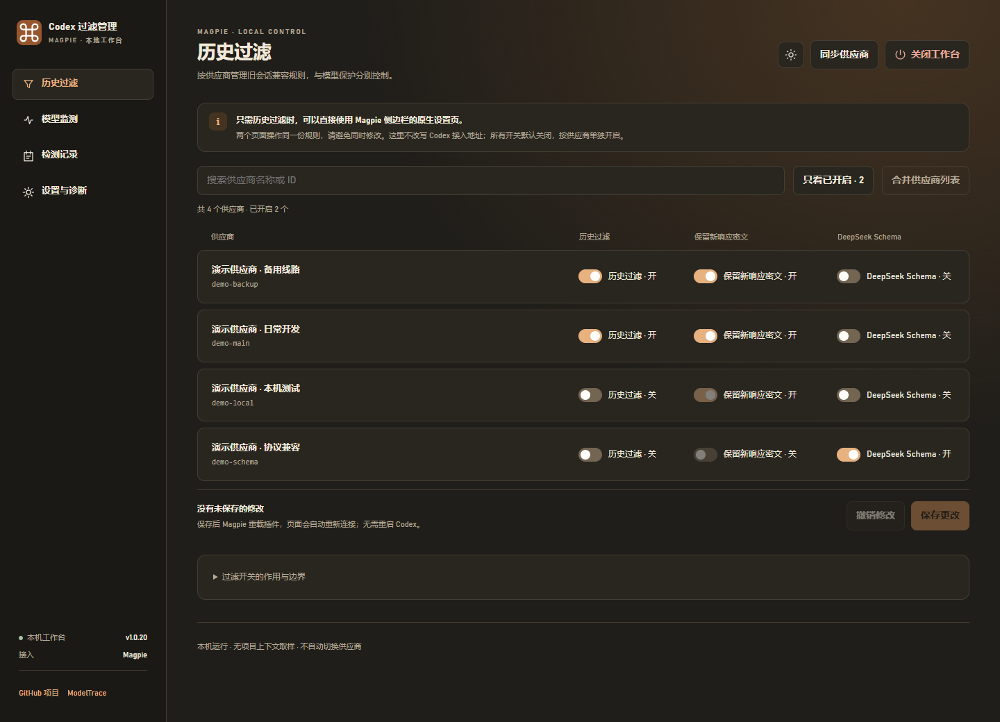

<details>
<summary>查看 Magpie 的模型监测、设置和检测记录</summary>

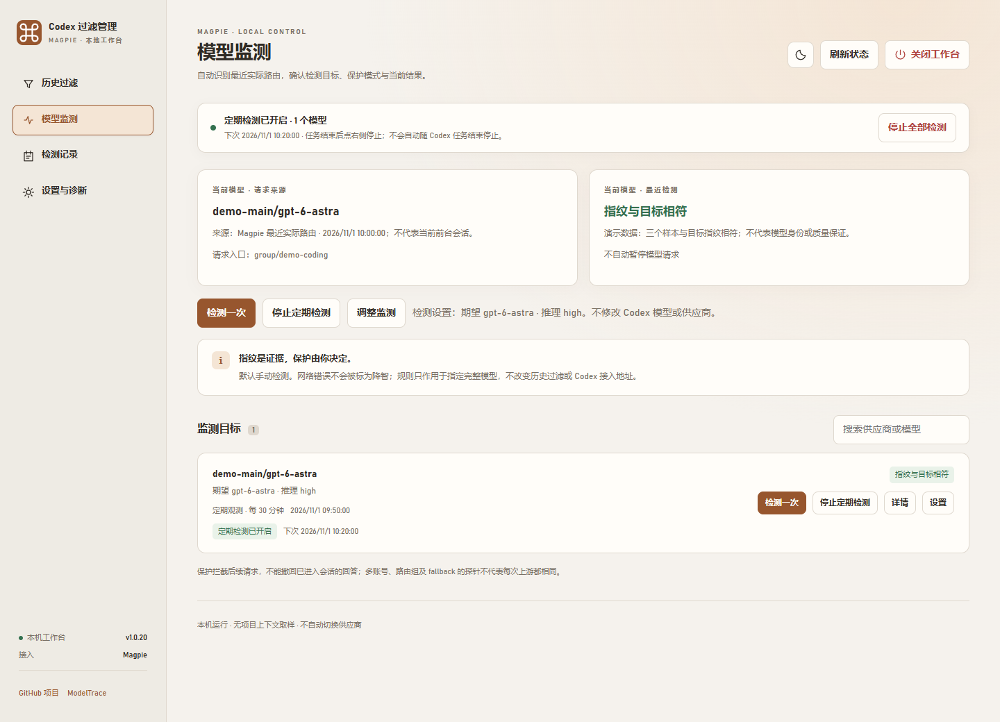
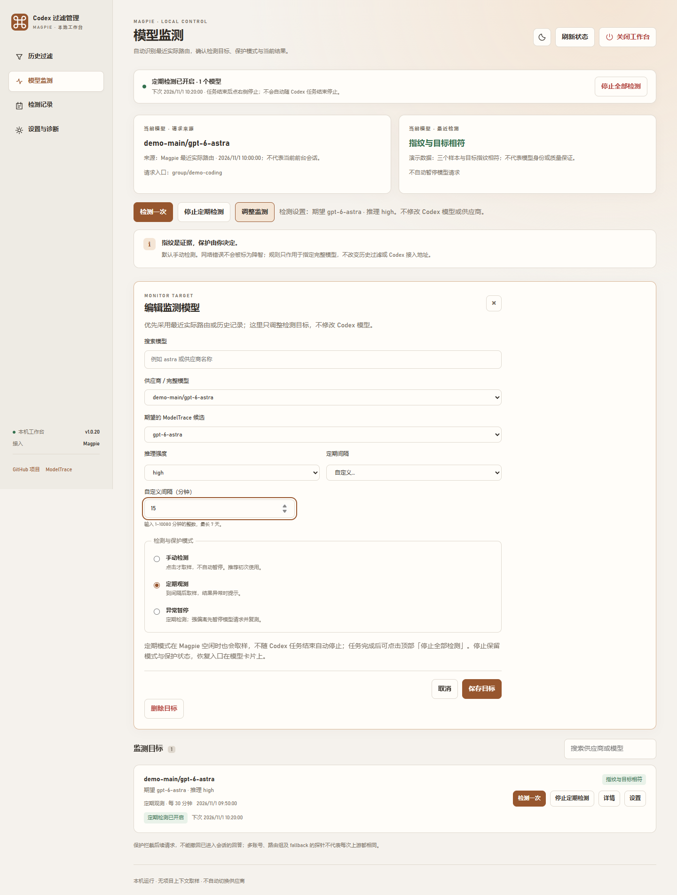
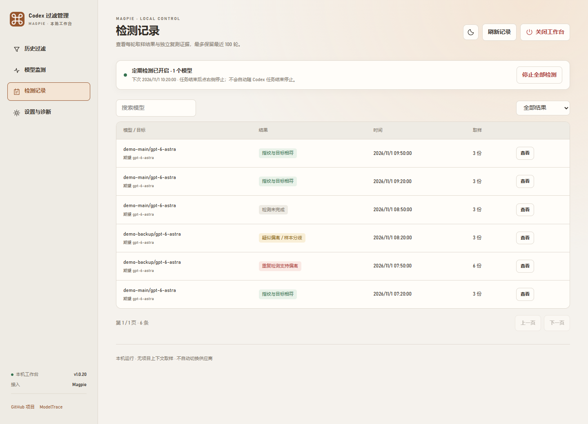
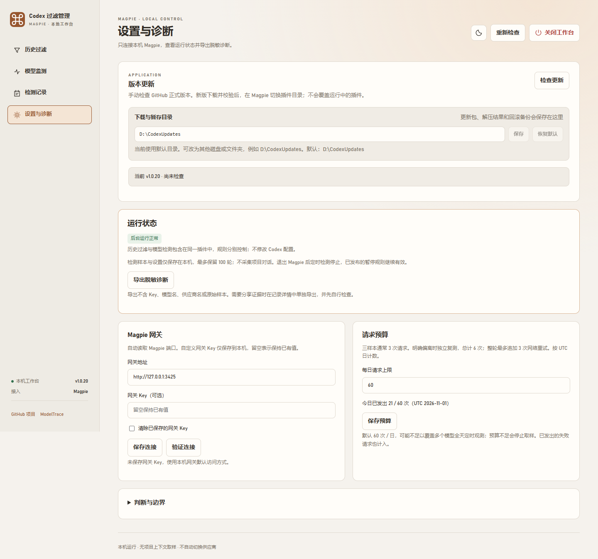

</details>

仅使用过滤时的 Magpie 原生设置页见 [Magpie 使用方式](docs/MAGPIE.md#全功能版)。

<details>
<summary>查看 CC Switch 管理界面</summary>

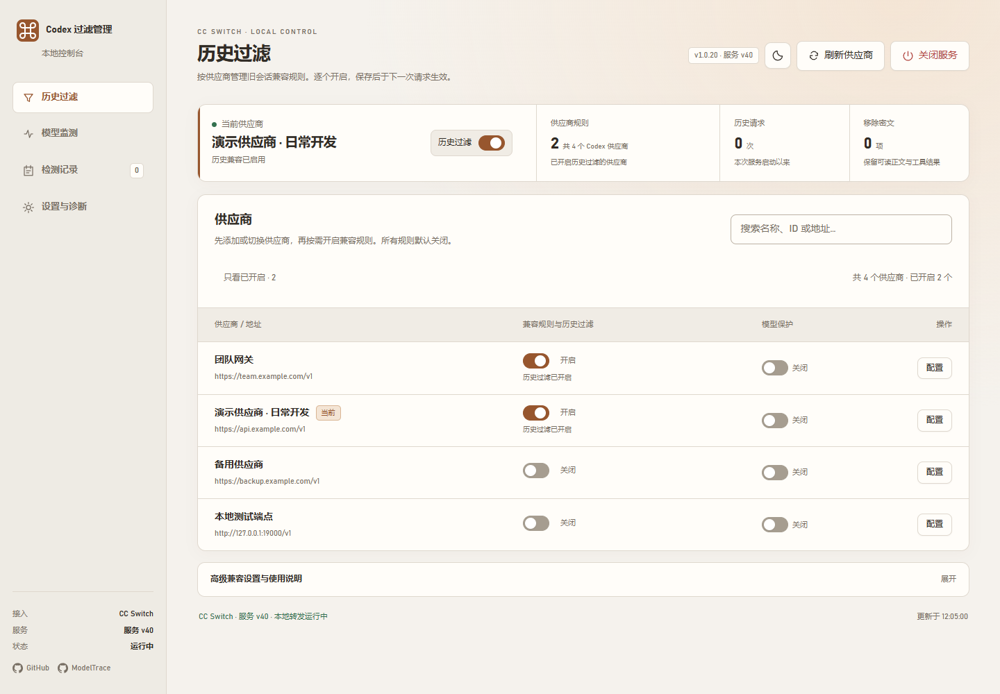
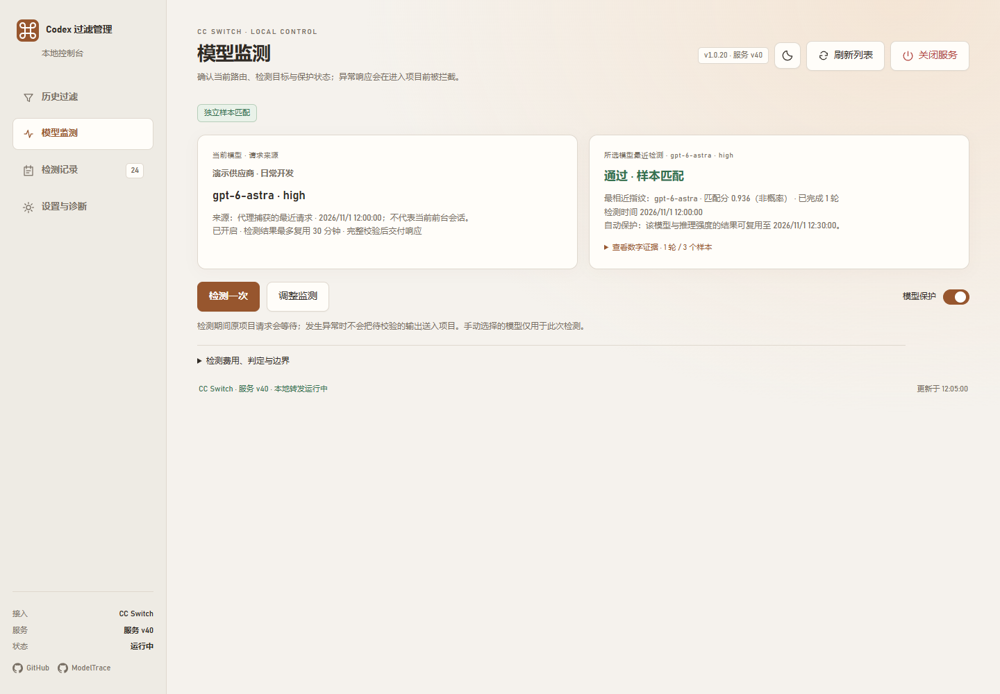
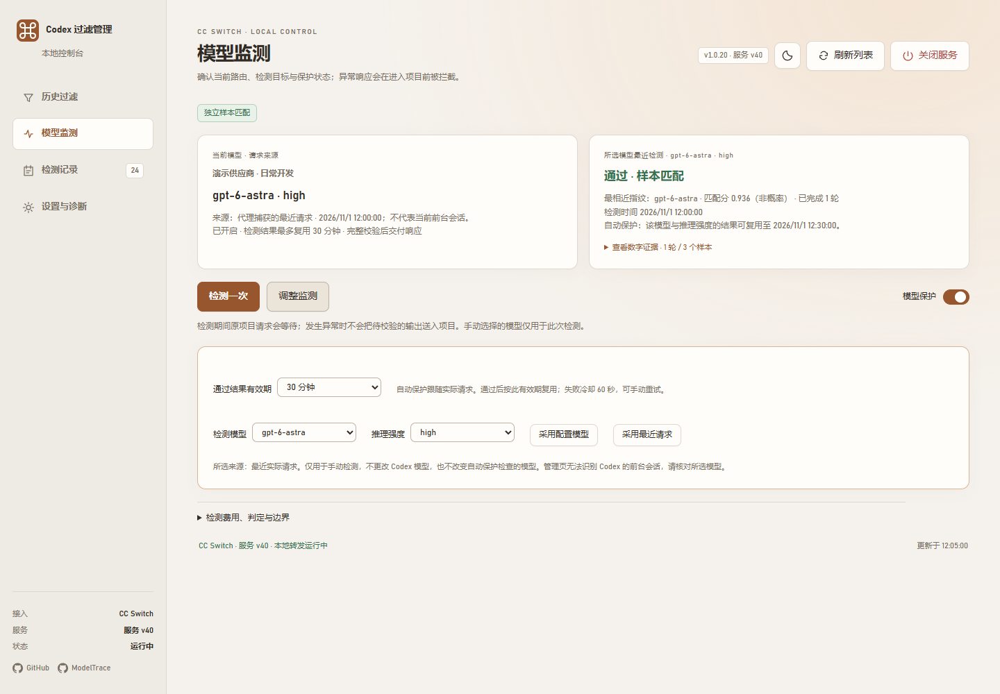
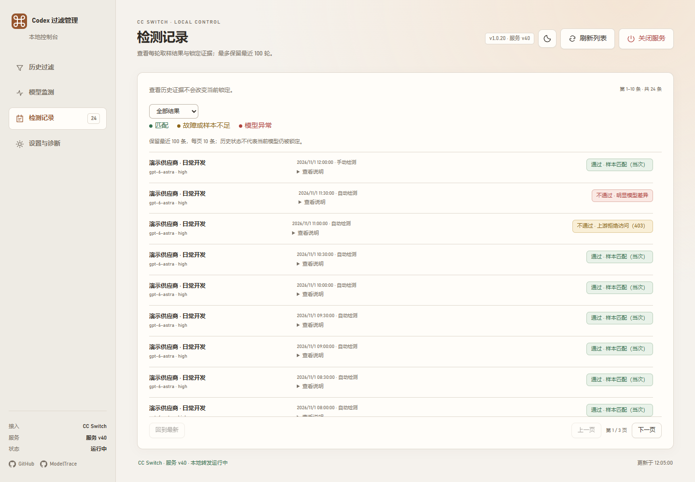
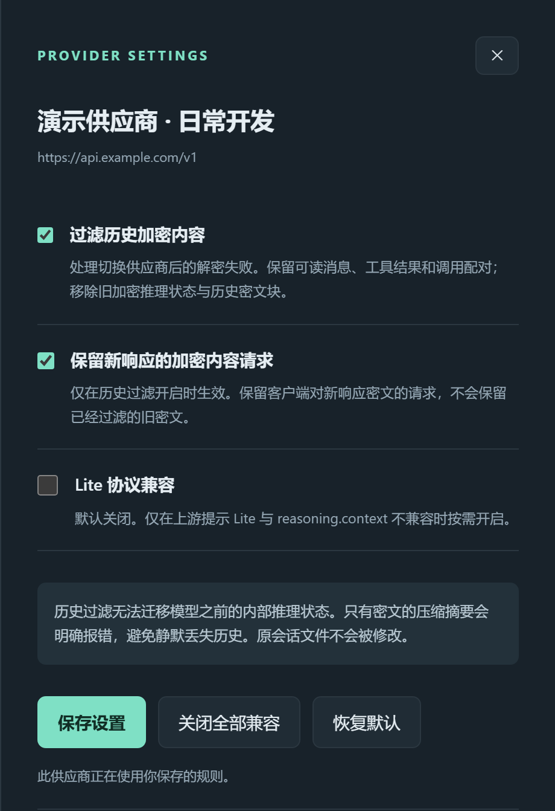
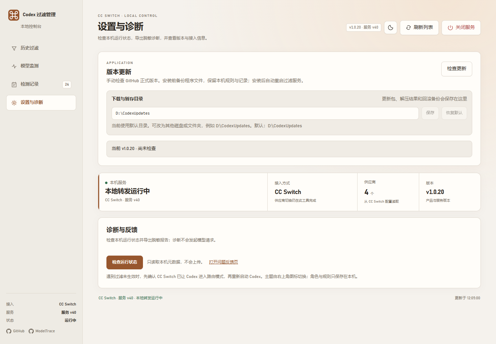
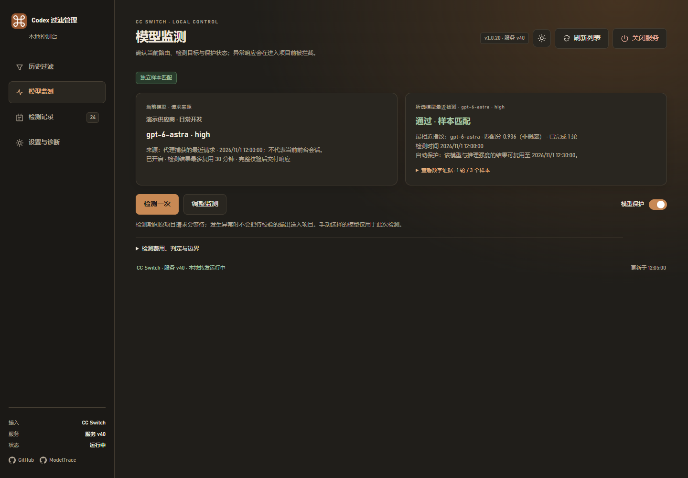

</details>

## 历史过滤

过滤按供应商独立保存，历史过滤、Lite 协议兼容和模型保护互不联动。新供应商默认关闭，兼容开关本身不会发起模型请求。

| 选项 | 作用 | 建议 |
| --- | --- | --- |
| 过滤历史加密内容 | 移除旧 reasoning、明确标记的密文和可移植条目中的服务器 ID，保留正文与工具配对 | 切换供应商后旧会话报密文或跨资源 ID 错误时开启 |
| 保留新响应的加密内容请求 | 保留客户端原有的 `reasoning.encrypted_content` 请求，不会恢复已经清理的旧密文 | 开启历史过滤时通常保持开启 |
| Lite 协议兼容 | 移除 Responses/Lite 扩展标头，不改模型与推理强度 | 仅在上游明确提示 Lite 与 `reasoning.context` 冲突时开启 |

推荐从 **前两项开启、第三项关闭** 开始。上游明确拒绝新响应密文请求时，再尝试关闭第二项。三个选项的完整原理、流程与截图见 [兼容规则说明](docs/COMPATIBILITY.md)。

服务 v33 起，历史过滤也会把旧 `web_search_call` 转换为带说明的普通助手文字，保留已记录的查询、动作和来源，避免旧搜索条目必须依赖已经被移除的 reasoning。该转换不会重新搜索，也不会补造结果。

## 兼容修复与流中断

`stream disconnected before completion: response.failed event received` 是客户端对上游失败事件的通用提示。本工具通过修正导致失败的请求内容，缓解以下兼容原因；不会把失败事件伪装成成功，也不保证修复全部断流。

| 实际上游原因 | 处理方式 |
| --- | --- |
| 旧历史密文验证失败、跨 Azure OpenAI 资源错误 | 开启历史过滤，递归清除协议密文和可独立重放条目的服务器 ID，保留正文与 `call_id`。无法恢复的加密压缩或服务器引用会明确拒绝。 |
| `web_search_call` 缺少关联 `reasoning` | 开启历史过滤，把旧搜索记录转为普通助手文字，保留已记录的查询、动作、状态和来源，不重搜或补造结果。 |
| DeepSeek 拒绝工具 Schema 根类型（`type: null`） | Magpie 中为对应供应商开启 **DeepSeek Schema**；候选供应商阶段将 `automation_update` 根联合折叠为对象，同时修复顶层、`tool_search_output` 和 `additional_tools` 的声明。 |

DeepSeek Schema 兼容独立于历史过滤，所有供应商默认关闭。折叠保留属性和局部定义，但会放宽根联合分支的互斥约束，执行仍由工具校验输入；只修改指定工具，普通工具结果保持原样。此兼容目前在 Magpie 插件路径提供，CC Switch 服务不因此自动获得 Schema 转换。认证、余额、429、网络故障或其他原生工具依赖应根据实际错误另行排查。

## 模型监测

模型监测使用 [ModelTrace](https://github.com/xqy2006/ModelTrace) 的出题器、评分逻辑和参考库，在本机通过当前供应商取样并评分。检测请求不携带项目对话，也不会改用 ModelTrace 的云端检测接口。

- **手动检测**：点击后才产生 3 个样本；强差异时可能追加复核，最多 6 个。
- **自动保护**（CC Switch）：请求响应完整验证后才交付；结果可按有效期复用，默认 10 分钟。
- **定期观测 / 异常暂停**（Magpie 工作台）：按 5、10、20、30、60 分钟或自定义间隔取样；任务结束时可从顶部一键停止全部轮询。

一轮通常产生 3 次计费请求，网络故障最多额外重试 3 次。匹配分是有限候选模型之间的相对证据，不是身份概率，也不能证明代码质量。网络错误、上游 403 和样本无效不会被标成“确认降智”。详细评分、重试、锁定和费用边界见 [模型保护说明](docs/MODEL-GUARD.md)。

## 数据与边界

- 过滤不解密密文、不改写 Codex 会话文件，只移除可安全丢弃的内部状态；无法安全迁移的服务器引用或加密压缩历史会明确拒绝。
- CC Switch 模式仅支持 Responses HTTP/SSE；自动故障转移、复杂路由组或其他接入方式可能让管理页无法准确识别当前供应商。
- CC Switch 开启模型保护后，响应会等待完整校验后再显示，不能逐字流出，也不能撤回已经执行的工具操作。
- Magpie 插件加载失败、超时或被宿主跳过时，请求可能继续放行；运行状态应以 Magpie 插件页为准。
- 管理端口只监听本机，不上传遥测。不要公开 `.runtime/`、Magpie 配置、API Key、会话文件或未检查的日志。

完整隐私说明见 [SECURITY.md](SECURITY.md)；常见错误与恢复步骤见 [排障文档](docs/TROUBLESHOOTING.md)。

## 诊断

在「设置与诊断」点击检查，可预览并下载只含运行元数据的 JSON；页面打不开时运行 `Diagnose.bat`。报告不包含对话、密钥、供应商地址或个人路径，也不会自动上传。反馈问题时请附上产品版本、服务版本、发生时间和操作步骤。

## 开发

需要 Node.js 24+，核心运行无第三方 npm 依赖：

```powershell
npm test
node magpie-workbench/tools/build-middleware.mjs
node --test magpie-workbench/test/*.test.mjs
powershell -File tests/launcher/launcher-check.ps1
```

目录职责、命令行参数、浏览器测试和提交要求见 [CONTRIBUTING.md](CONTRIBUTING.md)。

```text
AGENTS.md                仓库目录与提交规则（也供 AI 编码助手读取）
filter.cjs               稳定 CLI 入口
src/                     CC Switch 服务、过滤、模型保护与诊断
web/                     CC Switch 管理页面与共享静态资源
magpie-workbench/        完整 Magpie 插件、原生设置页与本机工作台
tests/                   自动测试、浏览器检查和固定测试数据
scripts/                 启动实现、打包、截图与手动检查工具
docs/                    使用、兼容、维护、排障与更新记录
```

## 许可与致谢

本项目采用 [MIT](LICENSE)。感谢以下开源项目，具体集成范围、固定来源与许可见[第三方说明](THIRD_PARTY_NOTICES.md)：

- [ModelTrace](https://github.com/xqy2006/ModelTrace)：已集成的模型行为指纹评分器、中文出题器和参考库。
- [Responses 历史回放补丁](https://github.com/yunhanhai/agentrouter-responses-shim-sentry-fix)：嵌套协议密文清理、copy-on-write 与兼容场景回归测试参考。
- [meow-llm-detector](https://github.com/chen-006/meow-llm-detector)：方法比较参考，未集成代码或数据。
- [CC Switch](https://github.com/farion1231/cc-switch)、[Magpie](https://github.com/yetone/magpie) 与 [Magpie 社区插件](https://github.com/magpie-community/plugins)：接入、插件接口与分发方式参考。

友情链接：[LINUX DO](https://linux.do/)
