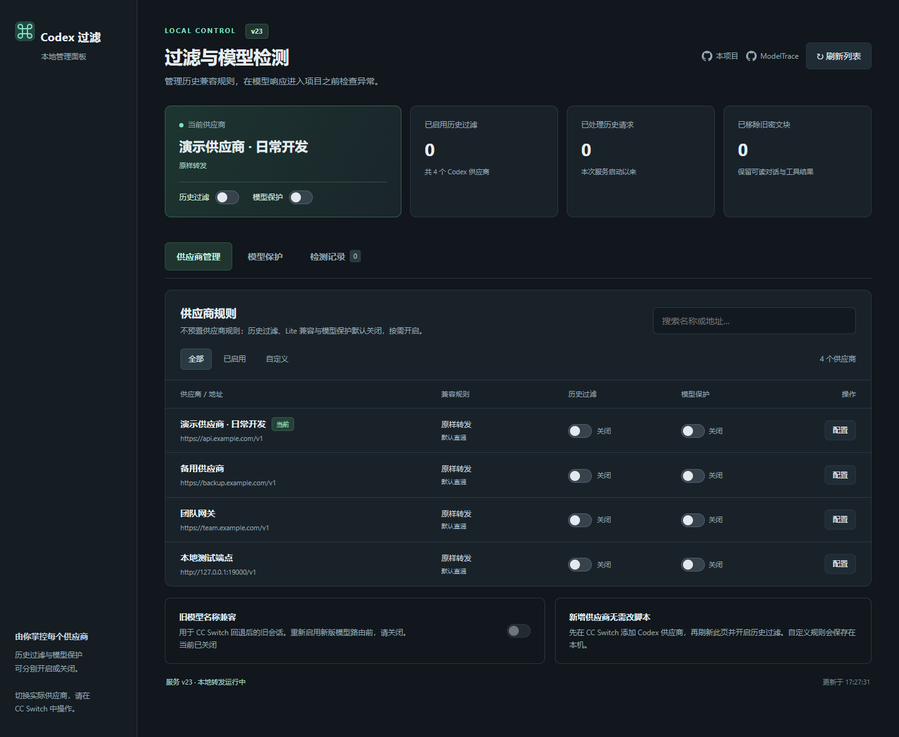
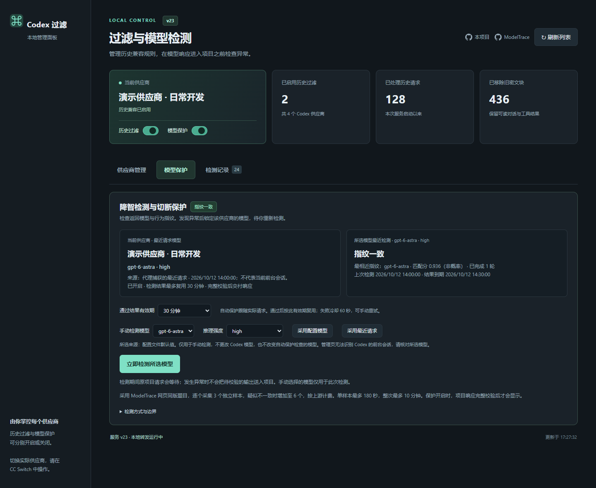
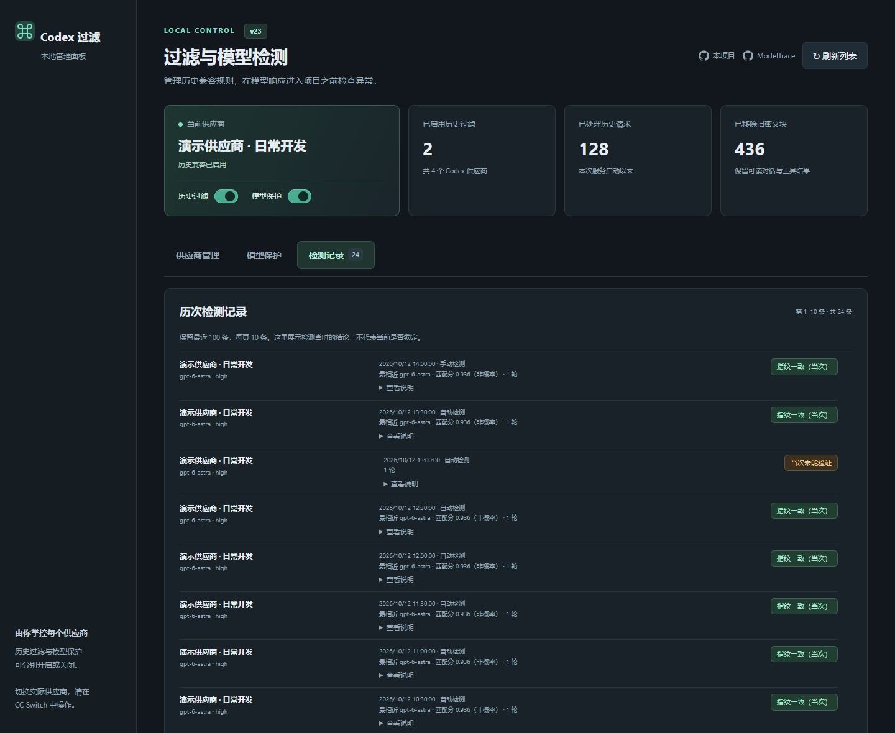
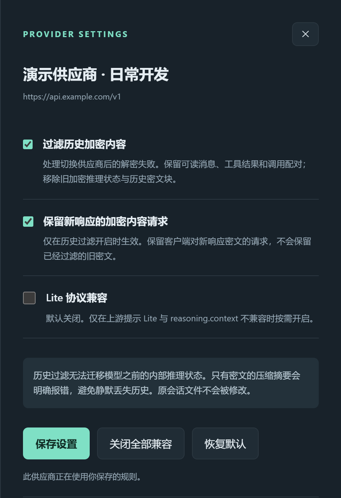

# Codex Filter Manager · Codex 过滤管理

一个运行在 **Codex 与 CC Switch 之间的本机代理**，提供可视化的供应商历史兼容设置与可选的模型一致性保护。适合切换供应商后，旧会话出现加密内容无法验证、历史 item ID 不属于当前上游等错误的用户。

**Windows 10 / 11 · 无需管理员权限 · 无需手动安装 Node.js 或 npm 依赖 · MIT**

当前版本：**1.0.2 / 服务 v23**。Release 和安装包使用发布版本号，管理页面显示服务版本号。

[GitHub 仓库](https://github.com/unisong/codex-filter-manager) · [下载最新版本](https://github.com/unisong/codex-filter-manager/releases/latest) · [反馈问题](https://github.com/unisong/codex-filter-manager/issues)

**1.0.2 更新：** 手动检测可明确选择模型与推理强度；自动检测失败后冷却 60 秒，减少客户端重试造成的重复探针和记录；采用 ModelTrace 网页同版中文出题器，逐个取样，单个样本最多等待 180 秒，并显示检测进度和具体失败原因。

> 本项目是独立社区工具，与 OpenAI、CC Switch 或任何供应商没有官方隶属关系。它可以缓解部分历史兼容问题；模型保护提供统计风险检查，不能证明模型能力，也不能保证杜绝“降智”或项目污染。

## 能做什么

| 功能 | 实际行为 |
| --- | --- |
| 历史过滤 | 按供应商清理可移植历史中的 reasoning 密文、部分服务器 item ID，保留普通消息、工具参数、工具结果与 call_id；不修改已有会话文件 |
| 可视化供应商管理 | 从 CC Switch 只读加载供应商；逐个开启或关闭历史过滤、模型保护和兼容选项，无需改脚本 |
| 模型一致性保护 | 在项目请求前发出独立数字样本探针；检测到重复的明显指纹差异或响应模型名不符时锁定，阻止受保护输出交付 |
| 响应检查 | 开启保护后缓存完整 Responses 响应，验证完成事件和模型字段，再交付客户端 |
| 历次检测记录 | 保留最近 100 次检测，每页 10 条，独立页签和列表内滚动；当前锁定独立显示 |
| 兼容性与恢复 | 部分供应商 Responses/Lite 兼容、受限的 429 排队重试，以及停止服务时恢复本工具接管的地址 |

转发路径：

```text
Codex → 本机过滤服务（默认 127.0.0.1:18181）→ CC Switch 本地代理 → 当前供应商
```

**检测算法来源：[xqy2006/ModelTrace](https://github.com/xqy2006/ModelTrace)。** 本项目集成 ModelTrace 的检测算法与参考库。检测请求通过用户配置的供应商完成，样本评分在本机执行。探针请求走你自己的 CC Switch 与供应商，可能计费。[检测原理与局限](MODEL-GUARD.md) · [第三方许可](THIRD_PARTY_NOTICES.md)

## 界面预览

以下截图使用虚构的演示供应商与检测数据。供应商页展示默认关闭的状态；模型保护与检测记录页演示手动开启后的效果，不代表任何真实供应商的检测结论。

**供应商管理：顶部快速切换，按供应商保存设置。**



<details>
<summary>展开查看模型保护与检测记录</summary>

**模型保护：手动选择模型检测、设置通过有效期、查看当前锁定。**



**检测记录：独立分页，不挤占供应商操作区域。**



</details>

## 点击即用

### 准备

- Windows 10 / 11，x64 或 ARM64；使用当前用户有写入权限的文件夹。
- 已安装并配置 [CC Switch](https://github.com/farion1231/cc-switch)，其 **本地代理** 与 **Codex 接管** 已开启。
- Codex 原本能够通过 CC Switch 新建会话并调用供应商。本工具不提供模型额度、API Key 或供应商账号。

### 首次启动

1. 从 [最新 Release](https://github.com/unisong/codex-filter-manager/releases/latest) 下载发布 ZIP，解压到准备长期使用的目录。不要在压缩包内直接运行。
2. 双击 **`Start.bat`**。启动器会寻找兼容的 Node.js；需要时从 `nodejs.org` 下载固定版本的便携运行时，校验 SHA-256 后放入项目的 `.tools/`。无需管理员权限，也不需要 `npm install`。
3. 浏览器打开 [管理页面](http://127.0.0.1:18181/__codex_filter__/ui)。启动器同时创建桌面的 **「Codex 过滤管理」** 快捷方式。
4. 确认服务已接入、CC Switch 可连接。**首次接入后完全退出并重新打开 Codex**，让客户端读取新的代理地址。
5. 新安装不附带供应商规则，历史过滤、Lite 兼容和模型保护均默认关闭。在页面为需要兼容的供应商开启「历史过滤」；「模型保护」按需单独开启。供应商切换仍在 CC Switch 操作。

首次运行需要联网下载便携运行时；之后可复用本机缓存。模型请求本身仍需要供应商可用。启动脚本的 `ExecutionPolicy Bypass` 只用于这一次进程，不修改系统执行策略。Windows 可能提示未签名下载文件；请先核对下载来源，无需关闭系统安全防护。

### 日常启动、停止与更新

| 操作 | 入口 |
| --- | --- |
| 启动并打开页面 | 桌面「Codex 过滤管理」或 `Start.bat` |
| 查看服务状态 | `Status.bat` |
| 停止并恢复地址 | `Stop.bat`，随后重启 Codex |
| 电脑重启后继续使用 | 再次双击桌面快捷方式；本工具不会注册开机自启动 |
| 更新 | 先运行旧目录的 `Stop.bat`，备份 `.runtime/`，将新版本解压覆盖到同一目录，再运行 `Start.bat`；不要用其他人的运行数据覆盖自己的 `.runtime/` |
| 卸载 | 先运行 `Stop.bat`，确认地址已恢复，再删除项目目录和桌面快捷方式 |

关闭浏览器不会停止后台服务。不要在服务运行时移动目录；需要搬迁时先停止，完整移动后从新目录启动并更新快捷方式。不要同时启动多个副本接管同一个 Codex 配置。

## 如何选择开关

在「供应商管理」中找到对应供应商，点击 **「配置」**，可设置以下三个兼容开关。它们按供应商分别保存，点击「保存设置」后对后续请求生效；与 ModelTrace 的「模型保护」独立。

公开版不附带任何供应商域名规则。首次安装和新增供应商均默认直通，不过滤历史、不移除 Lite 标头，也不自动运行模型检测。第二项「保留新响应的加密内容请求」虽然默认勾选，但只有开启第一项历史过滤后才会影响处理方式，单独勾选不会启用过滤。

### 推荐组合

| 使用场景 | 过滤历史加密内容 | 保留新响应的加密内容请求 | Lite 协议兼容 |
| --- | --- | --- | --- |
| 新安装或供应商使用正常 | **关闭** | 保持勾选，此时不参与处理 | **关闭** |
| 切换供应商后，旧会话提示密文验证失败或历史消息 ID 不属于当前上游 | **开启** | **建议勾选** | 关闭，除非同时出现 Lite 协议错误 |
| 仅出现 Lite 与 `reasoning.context` 不兼容错误 | 关闭 | 保持勾选，此时不参与处理 | **开启** |
| 同时出现旧历史密文问题与 Lite 协议错误 | **开启** | **建议勾选** | **开启** |

处理旧会话兼容问题时，推荐从 **「前两项勾选、第三项关闭」** 开始。如果上游明确拒绝请求中的 `reasoning.encrypted_content` 选项，再尝试取消第二项；400 错误原因很多，应先查看具体错误信息。三个兼容开关本身不会发起额外检测请求。

<details>
<summary>查看推荐设置截图：旧会话密文兼容</summary>

截图使用虚构供应商，展示手动开启后的推荐组合，并非新安装默认状态。模型保护需要另外开启。



</details>

### 1. 过滤历史加密内容

**用途：** 缓解切换供应商或账号后，旧会话出现 `encrypted content hydration failed`、密文无法验证或部分历史消息 ID 无法识别的问题。

**原理：** 在转发 Responses 请求前，脚本清理输入历史中的内部 `reasoning` 条目、明确标记的密文块，以及可移植消息和工具条目上的服务器 `id`。普通可读消息、工具参数、工具结果和配对用的 `call_id` 会保留；同时将请求设置为 `store: false`，按携带完整历史的方式继续调用。过滤发生在发送出去的请求中，**不会改写原会话文件，也不会解密旧密文**。

**边界：** 清理会丢弃部分内部推理状态，可能影响长任务连续性。遇到加密压缩摘要、`previous_response_id` 或 `item_reference` 等无法独立恢复的上下文，脚本会明确拒绝，不会静默删掉这些引用后假装历史完整；此时应整理明文任务摘要，再开新会话继续。历史过滤开启时也会拒绝 `/responses/compact`。

### 2. 保留新响应的加密内容请求

**用途：** 避免历史过滤一并删除客户端对本次新响应密文的请求，导致某些上游拒绝请求。

**原理：** 客户端请求中的 `include: ["reasoning.encrypted_content"]` 表示希望本次响应附带加密推理内容。历史过滤开启时，勾选此项会保留客户端原有的 `include`；取消勾选只从其中删除 `reasoning.encrypted_content`，保留其他选项。客户端未携带这一选项时，脚本不会主动添加。

**与第一项的关系：** 第一项清理的是 `input` 中的**旧历史**，第二项控制是否保留对**新响应**的密文请求。因此两项可以同时勾选，不会让已经过滤的旧密文重新进入请求。历史过滤关闭时，第二项不改变转发内容；取消勾选也不保证上游一定不返回密文。

**推荐：** 开启历史过滤时通常保持勾选，以保留客户端原有的请求意图；只有上游明确拒绝该 `include` 选项时再尝试关闭。

### 3. Lite 协议兼容

**用途：** 处理部分上游提示 Lite 与 `reasoning.context` 不兼容的请求错误。旧版界面中的名称为「HUB / Lite 协议兼容」，该功能也可用于其他存在相同问题的上游。

**原理：** 开启后，脚本从发往 `/responses` 或 `/v1/responses` 的 POST 请求中移除 `x-openai-internal-codex-responses-lite` 标头，不再声明使用该 Lite 扩展。这个开关本身不改请求正文、模型名称或推理强度，也不清理历史；可以独立于历史过滤使用。

**推荐：** 默认关闭，只有遇到对应协议错误时再开启。这里的 Lite 是请求协议标记，不表示低智模型；开启兼容也不会提高模型能力或启用降智检测。

### 保存、关闭与恢复

「关闭全部兼容」保存直通设置；「恢复默认」撤销该供应商的自定义兼容设置并恢复直通。历史过滤与模型保护独立保存，恢复兼容默认设置不会更改模型保护。更新时保留 `.runtime/` 即可保留自己已保存的设置；从 1.0.0 更新后，未曾自定义的供应商也会恢复直通，需要时请手动开启。

### 模型保护单独设置

**模型保护**默认关闭。开启前建议先手动检测，确认当前模型在参考库中且供应商接受探针请求。默认通过结果可复用 10 分钟，可改为每次请求或 1–60 分钟：例如 30 分钟到期后，**下一次受保护请求**会先重新检测；空闲时不会每隔 30 分钟自动调用模型。

自动保护使用**每条实际请求的模型和推理强度**。页面显示的最近请求可能来自其他会话，不代表当前前台会话；手动检测请核对所选模型和推理强度。手动检测不会修改 Codex 的模型设置，也不会覆盖最近请求的显示。

一次普通检测逐个发出 **3 个独立请求**，采用 ModelTrace 网页同版中文题目，每个要求生成 292–332 个 1–355 的整数；明显不一致时再发 3 个复核。探针不携带项目历史、文件或工具，可能消耗较多输出及推理 token。实际 token 与费用取决于供应商与模型，不能仅用数字数量推算。[完整检测说明](MODEL-GUARD.md)

受保护请求遇到超时、参考库未收录、结果模糊等情况也会停止放行，但这些结果属于 **“未能验证”**，不等同于“已确认降智”。清除锁定只是允许重新检测，不会直接判定通过。

检测失败后，同一路由、模型和推理强度进入 **60 秒冷却**。期间后续自动请求仍被拦截，但不再发探针或重复增加记录；到期后由下一次请求重试。手动检测可立即重试。此冷却与通过结果的 10 / 30 分钟有效期分别计算。

## 已知缺陷与边界

- **统计指纹不能证明质量。** 参考库有限，可能误报或漏报；探针和真实项目请求可能被路由到不同模型，响应模型名也可能被伪装。检测通过不是模型身份认证、质量保证或文件回滚机制。
- **开启保护会增加等待时间和调用费用。** 单个检测样本最多等待 180 秒，整次检测最多 10 分钟；页面显示轮次及样本进度。项目响应完整缓存后才放行，客户端会失去逐 token 的流式显示。单响应上限 16 MiB，并发缓存总上限 64 MiB，超限会拦截。
- **长会话压缩受限。** 历史过滤或模型保护生效时，不支持 `/responses/compact` 与不可迁移的加密压缩历史；长会话可能需要先生成明文任务摘要，再开新会话。
- **只支持 Responses HTTP/SSE。** 不支持 WebSocket，握手会返回 426；不是通用 Chat Completions 网关，也不是所有 Codex 配置来源的统一入口。
- **依赖 CC Switch 的本地数据库结构和接管配置。** 未来版本变更可能导致识别失败；复杂 TOML、配置 profile、命令行覆盖或其他客户端配置源也可能绕过接入。以页面接入状态和请求计数为准。
- **自动故障转移与验证冲突。** 开启 CC Switch 自动 failover 时，历史兼容处理会停用；存在已开启的模型保护而路由无法固定时，请求会被拒绝。避免在请求进行中切换供应商；本工具不能原子锁定 CC Switch 内部路由。
- **只提供 Windows 启动器与验证流程。** macOS/Linux 尚未提供开箱即用的部署支持；供应商和模型兼容性也需逐个确认。

常见错误、连接恢复和安全停用步骤见 [排障文档](docs/TROUBLESHOOTING.md)。

## 数据与隐私

管理服务只监听本机 `127.0.0.1`，使用本机管理令牌、同源校验与禁止跨域/嵌入策略。不要把管理端口映射到公网或作为共享网关使用。

本工具只读访问 CC Switch 数据库，不写入供应商 Key 或选择；为了接入代理，会修改当前 Codex 配置中的目标 `base_url` 并记录恢复信息。停止时只恢复本工具仍拥有的精确地址。模型保护会在内存中处理项目响应与探针所需认证头，正常日志不记录请求正文或鉴权头。没有项目自带的遥测上传功能。

以下数据留在本机，已由 `.gitignore` 排除，**不要随 Issue、截图或开源源码上传**：

| 位置 | 内容 |
| --- | --- |
| `.runtime/service.json` | 进程信息与本机控制令牌 |
| `.runtime/routes.json` | 接管前地址与恢复信息；恢复前不要删除 |
| `.runtime/provider-rules.json` | 供应商历史兼容规则与 ID |
| `.runtime/model-guard.json` | 模型保护设置、供应商标识、锁定与最近 100 次检测证据 |
| `.runtime/*.previous`、日志与其他备份 | 本机运行备份和诊断信息；可能含供应商名称或本机路径 |
| `.tools/` | 下载的便携 Node.js 运行时 |

详细安全边界与漏洞报告方式见 [SECURITY.md](SECURITY.md)。

## 开发与命令行

源码运行需要 **Node.js 24+**，运行时使用 Node 内置模块，无 npm 包依赖。

```powershell
node .\filter.cjs start
node .\filter.cjs status
node .\filter.cjs stop
```

默认读取 `%USERPROFILE%\.cc-switch\cc-switch.db` 和 `%CODEX_HOME%\config.toml`；未设置 `CODEX_HOME` 时读取 `%USERPROFILE%\.codex\config.toml`。CC Switch 监听端口从其数据库发现。

```powershell
# 仅在确有自定义路径或端口时指定；stop/status 必须使用相同 runtime。
node .\filter.cjs start --port 18181 --upstream http://127.0.0.1:15721 --config "D:\Codex\config.toml" --runtime "D:\FilterData" --cc-db "D:\CCSwitch\cc-switch.db"
```

`state=filtering` 表示配置地址已接入，不代表当前供应商的历史过滤或模型保护均已开启。已运行的客户端可能缓存旧地址；确认接入后重启客户端，并观察新请求是否使计数增长。

```powershell
npm test
```

离线自动测试使用临时配置、模拟 SQLite 数据库和本机 HTTP 服务，不调用真实模型、不改用户的 CC Switch 数据库或 Codex 配置。浏览器检查、源码结构和提交要求见 [CONTRIBUTING.md](CONTRIBUTING.md)。`live-check.cjs` 等真实连通性工具会调用当前供应商并可能计费，未包含在默认测试中。

## 来源与许可

本项目采用 [MIT License](LICENSE)。

- **已集成：[ModelTrace](https://github.com/xqy2006/ModelTrace)**，MIT；评分核心和参考库固定在提交 [`6cd4a8f`](https://github.com/xqy2006/ModelTrace/tree/6cd4a8ff0f3f4e49d6d6969dd2fbadfa1569fde2)，原许可证保留于 [`vendor/modeltrace/LICENSE`](vendor/modeltrace/LICENSE)。
- **仅调研：[meow-llm-detector](https://github.com/chen-006/meow-llm-detector)**，PolyForm Noncommercial；未集成其代码、数据或检测接口。
- **配套工具：[CC Switch](https://github.com/farion1231/cc-switch)**，需用户另外安装。本项目不会将其打包发行。

第三方组件仍遵循各自许可证，详情见 [THIRD_PARTY_NOTICES.md](THIRD_PARTY_NOTICES.md)。欢迎提交可复现的兼容性问题；反馈前请按排障文档移除个人信息与密钥。
